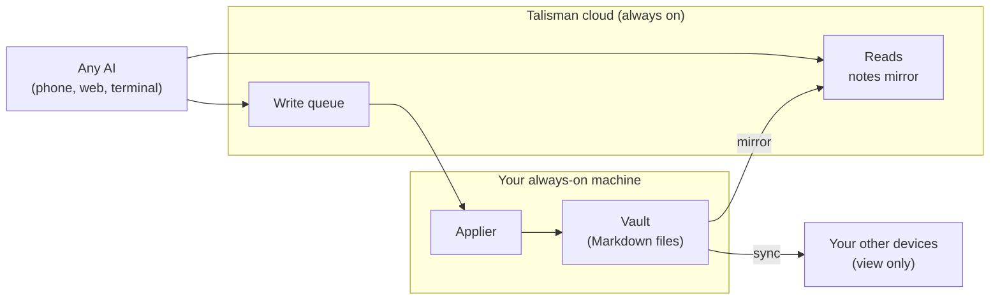

# Talisman

**Explain your work once. Every AI gets it.**

Talisman is a context manager for AI. Your notes are a plain Markdown vault (Obsidian-compatible) and stay the source of truth. Every AI you use — Claude, ChatGPT, Grok, Claude Code, Codex, Cursor, on any device — reads the same context through one connector, and writes back through one safe path.

> **Status: early.** A self-hosted connector on Cloudflare's free plan (see [Set up](#set-up)). AIs can read your notes, save session notes and create new notes; writes go through a queue and one applier on the machine that holds your vault.

## The problem

Every AI tool starts cold. You re-explain your projects in each chat, keep `CLAUDE.md`, `AGENTS.md` and custom instructions in sync by hand, and lose what each session decided the moment it ends. Notes apps hold the knowledge, but AIs can't safely read them from your phone, and letting several agents edit the same files at once is asking for trouble.

## How it works



- **The vault is the graph.** Notes are Markdown files and `[[links]]` are the edges. There is no separate database to lose: every copy of the vault carries the whole graph.
- **Reads are always available.** A searchable mirror of the vault lives in the cloud, so any AI can get context even when your computers are off.
- **One writer.** AIs never touch your files directly. Every write (a session summary, a handoff, a new note) goes into a queue, and a single applier on your always-on machine writes it into the vault, in order.
- **Nothing is lost, and nobody is fooled.** If the applier's machine is offline, writes wait in the queue and the AI is told so in its reply: writing is paused, reading still works.
- **Sessions capture themselves.** Hooks for coding agents send each conversation in as it grows, one record per conversation, summarized once it goes quiet and filed into the vault. Chat apps without hooks save sessions through a tool call.
- **Your notes stay yours.** No AI tool can edit or delete a note you wrote. Secrets are never stored.

## Pieces

| Piece | Job |
|---|---|
| Connector (MCP) | Context tools for any AI: who you are, search, read, follow links, recent sessions, resume a project or task, save a handoff, log a session |
| Read mirror | Always-on copy of the vault that the connector reads |
| Write queue | Ordered, versioned writes waiting to be applied; tells AIs when writing is paused |
| Applier | Runs on your always-on machine: applies queued writes, refreshes the mirror, checks in so Talisman knows it's alive |
| Capture | Hooks that send coding-agent conversations in as they grow |
| Backup (optional) | Nightly encrypted snapshots of the vault to S3-compatible storage |

## Set up

You need a Cloudflare account (the free plan is enough), Node 22.13 or newer, and Python 3.9 or newer on the machine that holds your vault. Everything runs in your own Cloudflare account: your notes are stored in your own D1 database and nowhere else.

**1. Get the code and create the database**

```sh
git clone https://github.com/23alcor/Talisman.git && cd Talisman
npm install
cp wrangler.example.jsonc wrangler.jsonc        # git-ignored: your IDs live here
npx wrangler d1 create talisman                 # paste the database_id into wrangler.jsonc
npx wrangler kv namespace create OAUTH_KV       # paste the id into wrangler.jsonc
```

Fill in `vars` in `wrangler.jsonc`: your first name, your time zone, the title of the note that describes you (`About Me` by default) and the folder your session notes live in (`Sessions` by default).

**2. Deploy and set the secrets**

```sh
npm run db:migrate
npm run deploy                                  # prints your Worker's URL

mkdir -p ~/.config/talisman && chmod 700 ~/.config/talisman
openssl rand -hex 32 > ~/.config/talisman/mcp-token    # for terminal AIs (Claude Code, Codex…)
openssl rand -hex 32 > ~/.config/talisman/sync-token   # for the sync client only
chmod 600 ~/.config/talisman/*-token
npx wrangler secret put TALISMAN_TOKEN < ~/.config/talisman/mcp-token
npx wrangler secret put SYNC_TOKEN < ~/.config/talisman/sync-token
npm run set-password                            # the password you'll type when connecting chat apps
```

**3. Fill the mirror**

On the machine with your vault:

```sh
python3 sync/talisman-sync.py --vault ~/Notes --url https://talisman.YOU.workers.dev \
  --token-file ~/.config/talisman/sync-token --exclude Templates --exclude Attachments
```

It sends only notes that changed and removes notes you deleted. `--exclude Templates` skips every folder named Templates; `--exclude Projects/Old` skips just that one. Folders starting with a dot and notes over 200 KB are always skipped. It refuses to run on an empty folder, or to remove more than half the mirror at once without `--allow-mass-delete`, so a missing drive can't wipe it. Run it on a timer, for example every five minutes with cron:

```
*/5 * * * * python3 /path/to/Talisman/sync/talisman-sync.py --vault /path/to/Notes --url https://talisman.YOU.workers.dev --token-file ~/.config/talisman/sync-token -q
```

**4. Connect your AIs**

- **Chat apps** (claude.ai, the Claude apps, ChatGPT and others that take a custom MCP connector): add a connector with the URL `https://talisman.YOU.workers.dev/mcp`. You'll be asked for your password, then to allow the app.
- **Claude Code:**
  `claude mcp add --transport http talisman https://talisman.YOU.workers.dev/mcp --header "Authorization: Bearer $(cat ~/.config/talisman/mcp-token)"`
- **Other terminal tools:** any client that speaks MCP over HTTP can send `Authorization: Bearer <mcp-token>`.

The connector has six read tools (`whoami`, `search_notes`, `read_note`, `list_notes`, `related_notes`, `recent_sessions`) and three write tools (`log_session`, `create_note`, `write_status`).

**5. Let AIs write**

Writes wait in a queue until the applier on your vault machine saves them. Run it on the one machine that holds your main vault, and nowhere else:

```sh
python3 sync/talisman-applier.py --vault ~/Notes --url https://talisman.YOU.workers.dev \
  --token-file ~/.config/talisman/sync-token --daily-log --project-log
```

- `log_session` writes a session note to `Sessions/YYYY-MM/`. When the AI sends an update with the same `session_id`, the applier rewrites that note in place. It won't touch a session note you've edited by hand.
- `create_note` adds a new note to an existing folder. It never overwrites a note.
- `--daily-log` and `--project-log` add one link line under `## Log` in that day's daily note and in the project's note. The daily note is made from your Obsidian daily-note template if it doesn't exist yet.
- Writes that look like they contain a password, key or token are refused.
- If the applier is offline, AIs are told that writing is paused, that their write is queued, and that reading still works.

It runs until stopped, so run it as a service. With systemd (`~/.config/systemd/user/talisman-applier.service`):

```ini
[Service]
ExecStart=/usr/bin/python3 /path/to/Talisman/sync/talisman-applier.py --vault /path/to/Notes --url https://talisman.YOU.workers.dev --token-file %h/.config/talisman/sync-token --daily-log --project-log
Restart=always
RestartSec=10

[Install]
WantedBy=default.target
```

After updating Talisman, run `npm run db:migrate` before `npm run deploy`.

**6. Capture coding agents' chats**

A hook sends each Claude Code or Codex chat to Talisman as it grows. It sends only what you and the assistant wrote: no tool output or injected system text, `<private>` spans removed, and anything shaped like a key, token or password redacted. After a chat has been quiet for 10 minutes, or has ended, Talisman summarizes it and the applier saves it as a session note with the transcript linked. As the chat continues, that same note is updated.

Summaries need a model. Set `SUMMARY_MODEL` in `wrangler.jsonc`, then add the key:

```sh
npx wrangler secret put OPENAI_API_KEY          # or any provider with an OpenAI-compatible Responses API (SUMMARY_BASE_URL)
```

Claude Code: add the hook to `~/.claude/settings.json`, for both `Stop` and `SessionEnd`:

```json
{ "hooks": {
  "Stop":       [{ "hooks": [{ "type": "command", "async": true, "timeout": 60,
                   "command": "python3 /path/to/Talisman/capture/talisman-capture.py claude-code --url https://talisman.YOU.workers.dev" }] }],
  "SessionEnd": [{ "hooks": [{ "type": "command", "async": true, "timeout": 60,
                   "command": "python3 /path/to/Talisman/capture/talisman-capture.py claude-code --url https://talisman.YOU.workers.dev" }] }]
} }
```

Codex: add the same two hooks to `~/.codex/hooks.json`. `--background` returns control to Codex at once, so it doesn't wait for the upload:

```json
{ "hooks": {
  "Stop":       [{ "hooks": [{ "type": "command", "timeout": 30,
                   "command": "python3 /path/to/Talisman/capture/talisman-capture.py codex --background --url https://talisman.YOU.workers.dev" }] }],
  "SessionEnd": [{ "hooks": [{ "type": "command", "timeout": 30,
                   "command": "python3 /path/to/Talisman/capture/talisman-capture.py codex --background --url https://talisman.YOU.workers.dev" }] }]
} }
```

On older Codex versions without hooks, use `notify = ["python3", "/path/to/Talisman/capture/talisman-capture.py", "codex", "--url", "https://talisman.YOU.workers.dev"]` at the top of `~/.codex/config.toml`. Codex runs only one notify program, so this replaces any you already have.

The hook reads the token from `~/.config/talisman/mcp-token`. `TALISMAN_CAPTURE=off` turns it off. `TALISMAN_CAPTURE_SKIP=/path/a:/path/b` never sends chats that ran in those folders. Chats under 1200 characters are skipped. If Talisman can't be reached, the hook tries again on its next run. It never slows or fails the agent, and its log is in `~/.local/state/talisman/capture.log`. To see exactly what would be sent for a chat, without sending anything: `python3 capture/talisman-capture.py build claude-code <chat file>`.

### Development

```sh
npm test                                        # runs on Node's built-in SQLite, no Cloudflare needed
npm run set-password -- --local                 # writes .dev.vars (git-ignored)
echo "TALISMAN_TOKEN=dev-token-123" >> .dev.vars && echo "SYNC_TOKEN=dev-sync-123" >> .dev.vars
npm run db:migrate:local && npm run dev
```

## Roadmap

1. ~~Connector and read mirror~~ (done)
2. ~~Write queue, applier, and the "writes paused" flow~~ (done: session notes and new notes; handoffs next)
3. ~~Capture hooks for Claude Code and Codex~~ (done)
4. Health: heartbeats, a status page and alerts that don't depend on your home machine
5. Search by meaning, not just keywords
6. Encrypted backups
7. Setup that works for someone who isn't me

Open questions: whether to offer a hosted service later (self-hosted for now); which model providers to support for summaries (OpenAI, Gemini, local).

## Credits

Inspired by [Grimoire](https://github.com/JeremiahM37/grimoire) and the Commonplace hackathon prototype. Talisman is its own code.

## License

[MIT](LICENSE)
