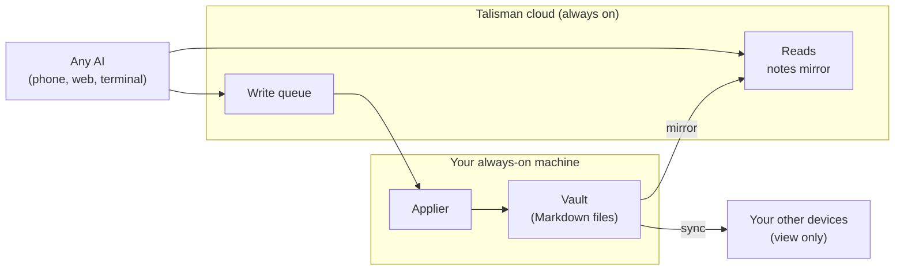

# Talisman

**Explain your work once. Every AI gets it.**

Talisman is a context manager for AI. Your notes are a plain Markdown vault (Obsidian-compatible) and stay the source of truth. Every AI you use — Claude, ChatGPT, Grok, Claude Code, Codex, Cursor, on any device — reads the same context through one connector, and writes back through one safe path.

> **Status: early.** The design below is settled; the code is being rebuilt here from a working personal setup and a hackathon prototype. Nothing is ready to install yet.

## The problem

Every AI tool starts cold. You re-explain your projects in each chat, keep `CLAUDE.md`, `AGENTS.md` and custom instructions in sync by hand, and lose what each session decided the moment it ends. Notes apps hold the knowledge, but AIs can't safely read them from your phone, and letting several agents edit the same files at once is asking for trouble.

## How it works

- **The vault is the graph.** Notes are Markdown files and `[[links]]` are the edges. There is no separate database to lose: every copy of the vault carries the whole graph.
- **Reads are always available.** A searchable mirror of the vault lives in the cloud, so any AI can get context even when your computers are off.
- **One writer.** AIs never touch your files directly. Every write (a session summary, a handoff, a new note) goes into a queue, and a single applier on your always-on machine writes it into the vault, in order.
- **Nothing is lost, and nobody is fooled.** If the applier's machine is offline, writes wait in the queue and the AI is told so in its reply: writing is paused, reading still works.
- **Sessions capture themselves.** Hooks for coding agents send each conversation in as it grows, one record per conversation, summarized once it goes quiet and filed into the vault. Chat apps without hooks save sessions through a tool call.
- **Your notes stay yours.** No AI tool can edit or delete a note you wrote. Secrets are never stored.

## Pieces

| Piece | Job |
|---|---|
| Connector (MCP) | Context tools for any AI: who you are, search, read, follow links, recent sessions, resume a project or task, save a handoff, log a session |
| Read mirror | Always-on copy of the vault that the connector reads |
| Write queue | Ordered, versioned writes waiting to be applied; tells AIs when writing is paused |
| Applier | Runs on your always-on machine: applies queued writes, refreshes the mirror, checks in so Talisman knows it's alive |
| Capture | Hooks that send coding-agent conversations in as they grow |
| Backup (optional) | Nightly encrypted snapshots of the vault to S3-compatible storage |

## Roadmap

1. Connector and read mirror
2. Write queue, applier, and the "writes paused" flow
3. Capture hooks for Claude Code and Codex
4. Health: heartbeats, a status page and alerts that don't depend on your home machine
5. Search by meaning, not just keywords
6. Encrypted backups
7. Setup that works for someone who isn't me

Open questions: self-hosted template versus hosted service; which model providers to support for summaries (OpenAI, Gemini, local).

## Credits

Inspired by [Grimoire](https://github.com/JeremiahM37/grimoire) and the Commonplace hackathon prototype. Talisman is its own code.

## License

[MIT](LICENSE)
